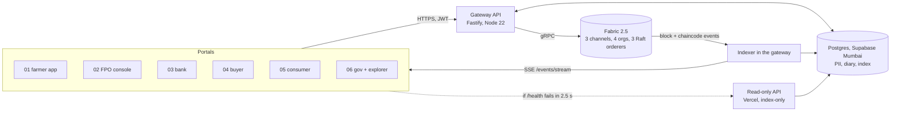

# 00-core-ledger

Academic prototype, RD61003, CRDIST, IIT Kharagpur, Group 7. Not a government, banking or payment service. The ledger is a live Hyperledger Fabric 2.5 network; external integrations (e-NWR repositories, UPI, eNAM, ONDC, AgriStack and others) are simulated adapters.

## What this is

The backend of FPO-SETU: a Fabric ledger shared by a Farmer Producer Company, a bank, a buyer and a regulator-observer, plus the one gateway API that the six portals call. It records the seven trust-critical events in the life of a produce lot (F1 to F7) and lets each party see only what its role allows.

## Why it exists

A smallholder cannot check what happened between a sale and the money received. A bank cannot tell whether a warehouse receipt is already pledged elsewhere. A buyer cannot verify origin or cold-chain claims. One record that no single party controls answers all three, and the three questions have three demo moments (see `docs/PROFESSOR_DEMO.md`): a second lien on the same e-NWR is rejected by chaincode, a price that only the FPO and the buyer can read while everyone else sees a hash, and a farmer statement read aloud in Bengali.

## Architecture



More detail, including what is on-chain and what is not, is in `docs/ARCHITECTURE.md`.

| Channel | Orgs | Chaincode (Go) |
|---|---|---|
| trace-channel | FPO, Bank, Buyer, Regulator | `lot-lifecycle` |
| finance-channel | FPO, Bank, Regulator | `pledge-lien` (loan terms in `loanTermsPDC`) |
| trade-channel | FPO, Buyer | `order-settlement` (price in `tradePricePDC`) |

## Run it (3 commands, WSL Ubuntu with Docker Desktop running)

```
make resume                      # restart the 12 Fabric containers on their existing volumes
cd gateway && pnpm start         # gateway + indexer on :8080 (leave running; open a second terminal)
make tunnel                      # publish :8080 on the reserved ngrok domain
```

Check: `curl localhost:8080/health` returns `"ledgerMode":"live"` and three channel heights. First-time setup (accounts, keys, `.env`, tunnel, Vercel read-API) and recovery are in `docs/RUNBOOK.md`.

| | URL |
|---|---|
| Gateway (API_URL) | `https://repaying-chant-consumer.ngrok-free.dev` (only while this PC runs `make tunnel`) |
| Read-only fallback (READ_API_URL) | `https://read-api-ten.vercel.app` (always on, `X-Ledger-Mode: index-only`, writes return 503) |

## Layout

| Path | What |
|---|---|
| `network/` | Fabric 2.5.x network, CAs, channels, identities (versions in `network/VERSIONS.md`) |
| `chaincode/` | Three Go chaincodes with unit tests (`make test`) |
| `gateway/` | API, indexer, simulated adapters, seed, e2e (`gateway/README.md`) |
| `read-api/` | Next.js route handlers on Vercel serving the same GETs from the Postgres index |
| `scripts/` | Chaincode deploy, CLI smoke test, tunnel, secret scan |
| `docs/` | `ARCHITECTURE`, `DECISIONS`, `DATA_SOURCES`, `RUNBOOK`, `PROFESSOR_DEMO` |
| `../shared/` | The contract all portals follow (`CONTRACT.md`, `contract.ts`, fixtures, mock gateway) |

## Make targets

`make up | resume | rebuild | down | status | logs | test | deploy | smoke | tunnel | tunnel-cf | test-db | check-secrets`. `make rebuild` wipes the ledger and takes about 20 minutes; the seed then takes about 44 minutes (`docs/RUNBOOK.md`, section 7).

## What is real and what is simulated

- Real: the Fabric network, the chaincode rules and every transaction ID, block number and endorser shown anywhere; AGMARKNET mandi prices (the current-day API plus a daily snapshot job; the history CSV loader exists but no CSVs were loaded when this was written; prices are never synthesised, and some markets or commodities report nothing on a given day, see `docs/DATA_SOURCES.md`).
- Simulated and labelled as such: e-NWR issuance (NERL/CCRL), UPI references, eNAM, ONDC, AgriStack, the weighbridge and quality meter (their readings are signed with device keys, so the chaincode verification is real).
- Placeholders: most deduction rates (hamali, market fee, commission, transport, cold-storage rent) and the lender haircut are `ASSUMPTION` values in `gateway/config/rates.json`, not sourced rates. Any statement computed from them is indicative. See `docs/DATA_SOURCES.md` and `docs/DECISIONS.md` D20.
- Custody model: each user maps to a custodial Fabric identity held by the gateway. A production system would use per-org HSM-backed keys.

## Not done

- `deploy/vm/` (an always-on cloud VM option) was deliberately skipped. The ledger is live only while this PC is on.
- The six portals live in their own folders (`../01-farmer-app` to `../06-gov-dashboard`) and have their own READMEs once built.
