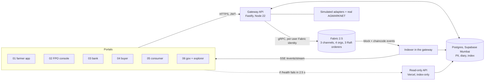

# Architecture (00-core-ledger)

Academic prototype, RD61003, CRDIST, IIT Kharagpur, Group 7. Six portals read and write one Hyperledger Fabric 2.5 ledger through one gateway API.

## Channels and chaincode

| Channel | Orgs | Chaincode | Endorsement | Private data |
|---|---|---|---|---|
| trace-channel | FPO, Bank, Buyer, Regulator | lot-lifecycle | any 3 of 4; custody writes also need FPO and Buyer | none |
| finance-channel | FPO, Bank, Regulator | pledge-lien | FPO and Bank | loanTermsPDC (FPO, Bank) |
| trade-channel | FPO, Buyer | order-settlement | FPO and Buyer | tradePricePDC (FPO, Buyer) |

The Regulator is not on trade-channel and not a member of loanTermsPDC. It never receives a price or loan terms.

## What is on-chain and what is not

| Data | Where | Why |
|---|---|---|
| Farmer name, phone, plot polygon, crop diary text | Postgres only | DPDP Act 2023: no personal data on-chain |
| Farmer token, device public key, consent hash, polygon hash, diary hash | trace-channel | pseudonymous, lets anyone verify a document against its hash |
| Lot state, grade, net weight, custody, cold-chain digests | trace-channel | the shared record all four orgs need |
| Loan terms, repayments | loanTermsPDC; copy in Postgres for the gateway | FPO and Bank only |
| Agreed price, settlement amount | tradePricePDC; copy in Postgres for the gateway | FPO and Buyer only; the public order carries only a salted hash |
| Per-member patronage payouts | trace-channel (see below) | member-auditable payouts |

## Deliberate decision: per-member patronage amounts are on trace-channel

`DistributePatronage` (F7) writes each member's `kg`, `gross`, `deductions` and `net` to trace-channel. This is a choice, not an oversight, and we keep it.

**Why.** The core trust problem this prototype addresses is that a smallholder cannot check what happened between a sale and the money they receive. A farmer, the FPO board, a bank officer or an observer must be able to take a member's statement and verify, on a ledger no single party controls, that the payouts and deductions of a run add up to the settlement amount and that each line is what the statement says. That is only possible if the amounts are on the shared ledger. A hash-only design would reduce the check to "trust whoever endorsed it".

**Who can derive the price.** On the ledger, `gross / kg` of a line is the price realised on that lot. The parties who can read it are the consortium members on trace-channel: the FPO and the Buyer (who agreed the price), the Bank and the Regulator. The Bank and the Regulator have a legitimate need to see price realisation: the bank to value collateral and monitor repayment capacity, the observer to check that members receive a fair share. They are admitted organisations bound by the consortium rules, not the public.

**What stays private.** The price is not visible to the public, to consumers, to competitors of the Buyer, or to any organisation outside the consortium, because: (1) it never appears on public-facing endpoints or in chaincode events, (2) the F6 agreement happens in tradePricePDC, so the price is never written to trade-channel public state, and trade-channel does not include the Bank or the Regulator, (3) the gateway filters every response by role (CONTRACT.md Section 9.4), so the Observer and Bank portals show realised-value metrics, not a quoted price per quintal, and (4) the chaincode refuses to put a price, amount or name in any event (`common.Emit`).

**Cost we accept.** Anyone who runs a trace-channel peer can read these amounts directly from their own ledger copy, bypassing the gateway filter. Joining the consortium means accepting that. If the consortium later wants the Regulator to see equity metrics only, the change is to move the lines into a collection shared by FPO and Buyer and keep only totals and hashes on trace-channel.

## Custodial identity model (prototype)

Each JWT user maps to an enrolled Fabric identity held in `wallet/` by the gateway. Production would use per-org HSM-backed keys and the user's own credentials. Members never submit directly: the farmer's device signature (ECDSA P-256) over the lot payload is what chaincode F2 verifies, and the gateway submits through the VLE identity. Follow-up calls that mirror a status (for example `SetPledged` after a lien) use a named service identity of the FPO org.

## Lot status lives on trace-channel

Finance and trade transactions cannot write trace-channel state, so after a deposit, lien, order, price agreement or settlement commits, the gateway submits a follow-up `lot-lifecycle` call. See DECISIONS D5. The explorer shows both transactions, and a failed follow-up is reported, never hidden.

## Read path and offline behaviour

The indexer follows each channel's block events, stores blocks, transactions and VALID chaincode events in Postgres, and refreshes the affected entity by querying chaincode. The read-only API on Vercel serves every GET from that index with `X-Ledger-Mode: index-only` while the PC (and therefore Fabric) is off. It never invents a transaction ID, block number or endorsement.
